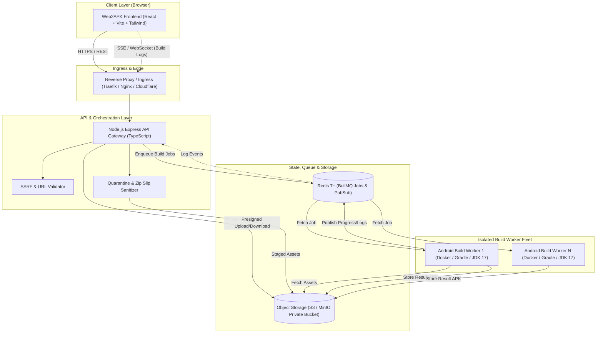
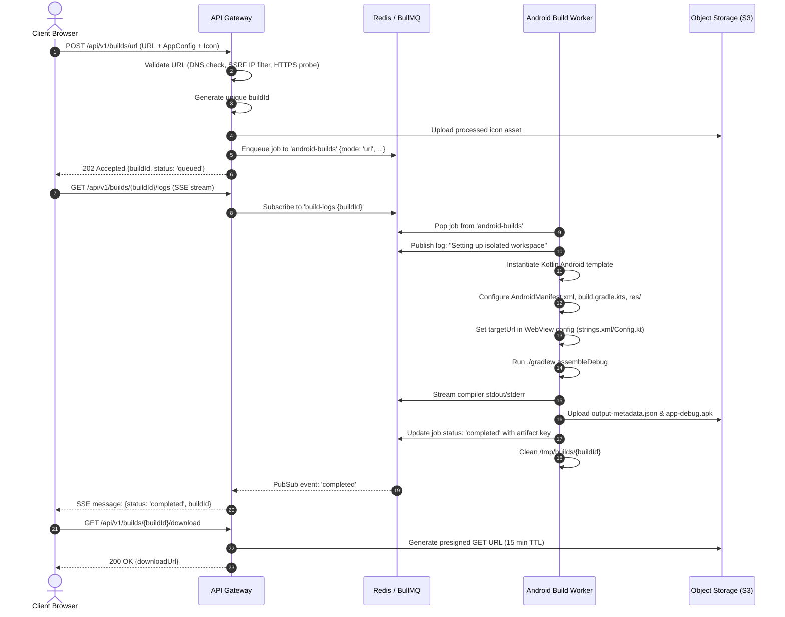
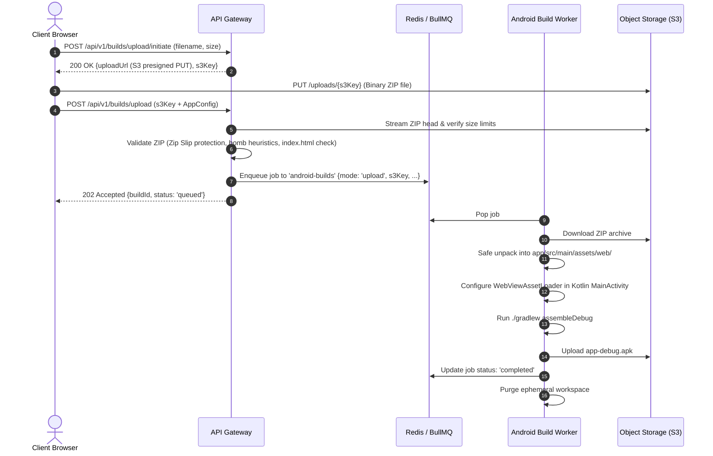
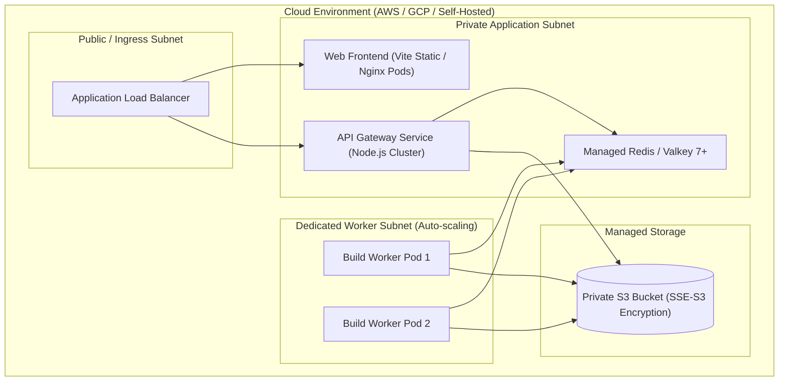

# Web2APK Architecture Documentation

## 1. System Overview

Web2APK is an enterprise-grade, distributed pipeline designed to convert web properties (public web URLs or static website archives) into fully functional, production-ready Android APK packages.

The system is architected around decoupling user-facing presentation and API gateway layers from resource-intensive, isolated Android compiler workers.



---

## 2. Core Subsystems

### 2.1 Frontend Client (`apps/web`)
- **Technology**: React 18+, Vite, TypeScript, Tailwind CSS, Lucide Icons, TanStack Query, Axios.
- **Role**:
  - Multi-step builder wizard for configuring application metadata (Name, Package Name, Version, Orientation, App Icon, Splash Screen, Permissions, WebView options).
  - Mode toggle: **URL Mode** (public web validation) vs. **Upload Mode** (drag-and-drop ZIP archive).
  - Real-time build monitor with terminal log streaming via Server-Sent Events (SSE).
  - Secure APK download delivery with QR code installation link.

### 2.2 API Gateway & Orchestrator (`apps/api`)
- **Technology**: Node.js, Express, TypeScript, Zod schema validation, BullMQ producer, AWS SDK v3 (S3).
- **Role**:
  - Request ingestion, rate limiting, and strict input schema validation.
  - SSRF protection engine with DNS resolution and private network IP filtering.
  - Zip quarantine, structure validation, and secure stream extraction.
  - Job dispatching to BullMQ queue `android-builds`.
  - SSE endpoint for multiplexing build logs from Redis Pub/Sub directly to the browser.
  - Presigned URL generation for secure, temporary artifact downloads (no public S3 buckets).

### 2.3 Job Queue & Event Broker (`infrastructure/redis`)
- **Technology**: Redis 7+ Alpine.
- **Role**:
  - BullMQ persistent job queues:
    - `android-builds`: Task management, priority handling, retries, and rate limits.
  - Redis Pub/Sub channels (`build-logs:<buildId>`): Low-latency real-time build stdout/stderr streaming from workers to API gateway.

### 2.4 Private Object Storage (`infrastructure/storage`)
- **Technology**: AWS S3 or MinIO (local dev / self-hosted S3-compatible storage).
- **Role**:
  - `uploads/`: Quarantined static site archives and user-uploaded icon assets.
  - `artifacts/`: Generated APK files, build manifests, and signed release packages.
  - Access model: 100% private bucket. All client interactions use short-lived presigned URLs (15-30 minute TTL).

### 2.5 Isolated Android Build Worker (`apps/worker`)
- **Technology**: Dockerized Linux (Ubuntu 22.04 LTS), Eclipse Temurin JDK 17, Android SDK Command-line Tools, Android Build Tools 34.0.0, Gradle 8.5+, Node.js (runner script).
- **Role**:
  - Consumes jobs from `android-builds` queue.
  - Scaffolds a dedicated ephemeral workspace per job.
  - Injects dynamic metadata into a clean Kotlin Android WebView template (`packages/android-template`).
  - Executes Gradle compilation (`./gradlew assembleDebug` or `./gradlew assembleRelease`).
  - Packages and signs APK with a generated or provided Keystore.
  - Streams step-by-step telemetry and Gradle build logs to Redis Pub/Sub.
  - Uploads compiled APK to private Object Storage and marks job complete.
  - Destroys ephemeral workspace on completion/failure.

---

## 3. Data Pipelines & Flow

### 3.1 Pipeline A: URL Mode



#### Detailed URL Mode Steps:
1. **Pre-flight & SSRF Validation**: The target URL is parsed. Hostname is resolved to IPv4/IPv6 addresses via DNS. Address is verified against private IP blacklists (RFC 1918, RFC 3927, RFC 6890, loopback `127.0.0.1`, cloud metadata IP `169.254.169.254`).
2. **Icon & Asset Processing**: If the user provides an icon, it is resized to standard Android mipmap resolutions (mdpi, hdpi, xhdpi, xxhdpi, xxxhdpi) using Sharp before passing to S3.
3. **Template Scaffolding**: Worker mounts the base Kotlin template to an ephemeral build directory `/builds/{buildId}`.
4. **Configuration Injection**:
   - `applicationId` set in `app/build.gradle.kts`
   - `versionCode` and `versionName` injected
   - `app_name` and `target_url` injected into `app/src/main/res/values/strings.xml`
   - Permissions (Camera, Location, Notifications) dynamically inserted into `AndroidManifest.xml`
   - Orientation locked or unlocked in `AndroidManifest.xml`
5. **Gradle Build Execution**: Worker executes isolated Gradle command:
   ```bash
   ./gradlew assembleDebug --no-daemon --stacktrace -Dorg.gradle.jvmargs="-Xmx2048m -XX:MaxMetaspaceSize=512m"
   ```
6. **Artifact Upload**: Output APK at `app/build/outputs/apk/debug/app-debug.apk` is uploaded to `s3://web2apk-artifacts/{buildId}/app-debug.apk`.

---

### 3.2 Pipeline B: Upload Mode (Static Website ZIP)



#### Detailed Upload Mode Steps:
1. **Direct-to-S3 Presigned Upload**: To avoid overloading the Node.js API with large file transfers, client uploads the ZIP directly to an S3 quarantine path using a presigned PUT URL with restricted Content-Length.
2. **Archive Sanitization**:
   - Total uncompressed size limit enforced (max 100 MB).
   - Compression ratio limit enforced (max 10:1 ratio to thwart decompression bombs).
   - File entry validation: disallow entries starting with `/` or containing `..` or null bytes.
   - Entry count limit (max 5,000 files).
   - File type blacklist: rejects any `.exe`, `.sh`, `.bat`, `.apk`, `.dex`, `.so`, `.elf`.
   - Entrypoint verification: confirms existence of `index.html` either at root or inside a single top-level folder.
3. **Local Android Asset Loader**:
   - Extracted files are placed in `app/src/main/assets/web/`.
   - Android app uses `androidx.webkit.WebViewAssetLoader` with domain `https://appassets.androidplatform.net/assets/web/index.html`.
   - **Crucial Security Rule**: Never enables `setAllowFileAccessFromFileURLs(true)`. Asset loader guarantees assets are served over a secure virtual origin, enabling modern web features (CORS, Fetch API, LocalStorage) without exposing the Android filesystem.

---

## 4. Worker Isolation & Resource Management

Android builds consume significant CPU and memory. In production, workers must be strictly contained:

| Resource Constraint | Value | Rationale |
| :--- | :--- | :--- |
| **Worker Concurrency** | 1 build per worker container | Prevents Gradle OOM and CPU thrashing |
| **Worker Container Memory** | 4.0 GB RAM limit | Android Gradle daemon requires ~2GB; OS & tools need ~1GB |
| **Worker Container CPU** | 2.0 vCPU | Prevents thread saturation on multi-tenant nodes |
| **Hard Build Timeout** | 10 minutes | Kills stuck Gradle daemons, deadlocks, or long downloads |
| **Workspace Cleanup** | Ephemeral volume per build | `/tmp/builds/{buildId}` is deleted in a `finally` block |
| **User Privileges** | Non-root (`gradleuser` UID 1001) | Hardens container against Gradle breakout vulnerabilities |
| **Docker Base Image** | `eclipse-temurin:17-jdk-jammy` | Official OpenJDK LTS base image with Android CLI tools pre-cached |

---

## 5. Deployment Topology



- **API & Frontend**: Lightweight, horizontally auto-scaled based on HTTP request volume.
- **Workers**: Scaled based on BullMQ `waiting` queue depth (e.g., using Kubernetes KEDA or AWS ECS target tracking based on queue length metrics).
