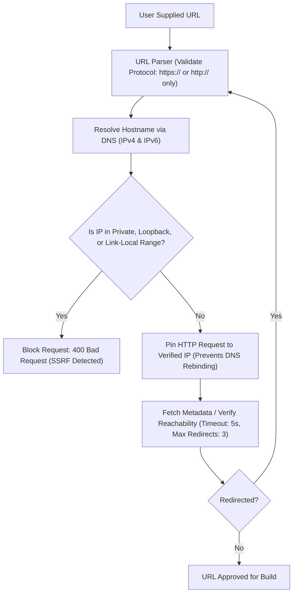

# Web2APK Security & Threat Model

Web2APK ingests untrusted user input (public URLs, uploaded ZIP archives, custom app icons) and compiles it into an executable binary (Android APK) using a distributed containerized worker fleet. This architecture presents unique threat surfaces that demand defense-in-depth.

---

## 1. Threat Matrix & Mitigations

| Threat Vector | Potential Impact | Severity | Primary Defenses |
| :--- | :--- | :--- | :--- |
| **Server-Side Request Forgery (SSRF)** | Internal network reconnaissance, cloud metadata exfiltration (`169.254.169.254`) | **Critical** | DNS pre-resolution, private IP subnet blacklisting, redirect validation, protocol pinning |
| **Zip Slip (Path Traversal)** | Arbitrary file overwrite on worker filesystem, code execution on worker host | **Critical** | Strict path canonicalization, rejection of parent dir `..` sequences, absolute path rejection, symlink rejection |
| **Decompression Bomb (Zip Bomb)** | Worker disk exhaustion, Out-Of-Memory (OOM), Denial of Service | **High** | Pre-extraction size checks, max compression ratio (10:1), max uncompressed size (100MB), max entry count (5000) |
| **Malicious Executable Injection** | Delivery of trojans or malware disguised as website assets | **High** | Blacklist of executable extensions (`.sh`, `.exe`, `.so`, `.apk`, `.dex`), asset quarantine |
| **Android WebView Vulnerabilities** | In-app XSS, local file stealing (`file://`), SSL MITM, unauthorized intent invocation | **High** | `WebViewAssetLoader` virtual origin, SSL error blocking, disabled cleartext HTTP, safe intent scheme parser |
| **Worker Sandbox Escape** | Host system compromise, cross-tenant data leak | **Critical** | Unprivileged container (`gradleuser`), read-only rootfs, cgroups memory/CPU limits, ephemeral build workspace |
| **Keystore / Secret Leakage** | Compromised signing keys, access to unauthorized releases | **High** | Ephemeral debug keystores generated on the fly, logs scrubbed of keystore passwords, zero secrets in source control |
| **Storage / S3 Unauthorized Access** | Leaked customer APKs or uploaded source archives | **High** | 100% private buckets, short-lived presigned URLs (15 min TTL), no public read ACLs |

---

## 2. SSRF Prevention Engine (URL Mode)

When validating and fetching website assets or favicons, the API executes a multi-stage validation check:



### 2.1 Blocked CIDR Subnets
The SSRF filter blocks the following network ranges without exception:
- `0.0.0.0/8` (Broadcast / current network)
- `10.0.0.0/8` (Private network RFC 1918)
- `100.64.0.0/10` (Shared address space RFC 6598)
- `127.0.0.0/8` (Loopback RFC 1122)
- `169.254.0.0/16` (Link-local RFC 3927 — **Cloud instance metadata**)
- `172.16.0.0/12` (Private network RFC 1918)
- `192.0.0.0/24` (IETF protocol assignments)
- `192.0.2.0/24` (TEST-NET-1 documentation)
- `192.168.0.0/16` (Private network RFC 1918)
- `198.18.0.0/15` (Network benchmark tests)
- `198.51.100.0/24` (TEST-NET-2)
- `203.0.113.0/24` (TEST-NET-3)
- `224.0.0.0/4` (Multicast RFC 5771)
- `240.0.0.0/4` (Reserved RFC 1112)
- `::1/128`, `fc00::/7`, `fe80::/10` (IPv6 Loopback and Unique Local)

---

## 3. Zip Extraction & Sanitization (Upload Mode)

ZIP files uploaded by users are considered hostile. Extraction uses a streaming, validated unpacker that enforces:

### 3.1 Zip Slip Defense
```typescript
// Canonical Path Check Logic
const destinationDir = path.resolve('/tmp/builds', buildId, 'app/src/main/assets/web');
const targetPath = path.resolve(destinationDir, entry.path);

if (!targetPath.startsWith(destinationDir + path.sep)) {
  throw new SecurityError(`Path traversal detected in archive entry: ${entry.path}`);
}
```

### 3.2 Zip Bomb Defense
- **Max Uncompressed Archive Size**: 100 MB (`104,857,600 bytes`).
- **Max File Count**: 5,000 files.
- **Max Single File Size**: 25 MB.
- **Compression Ratio Cap**: If `uncompressedSize / compressedSize > 10`, abort extraction immediately.
- **Streaming Byte Counter**: Extractor tracks total uncompressed bytes read in real-time. If the threshold is breached, the stream is aborted and deleted.

### 3.3 Prohibited File Types
Any archive containing files matching the following patterns is rejected immediately:
- Executables & scripts: `*.exe`, `*.bat`, `*.cmd`, `*.sh`, `*.bin`, `*.elf`, `*.com`
- Android / Java binaries: `*.apk`, `*.aab`, `*.dex`, `*.class`, `*.jar`, `*.so`
- Symbolic or hard links: Symlinks in ZIP entries are rejected to prevent file link hijacking.

---

## 4. Android WebView Security Hardening

The generated Android project (`packages/android-template`) is built with strict security defaults:

### 4.1 Asset Serving via `WebViewAssetLoader`
Traditional WebViews often enable `setAllowFileAccessFromFileURLs(true)`, allowing malicious JavaScript or cached assets to read local files (such as SQLite databases, cookies, or shared preferences).

Web2APK uses AndroidX `WebViewAssetLoader`:
```kotlin
val assetLoader = WebViewAssetLoader.Builder()
    .addPathHandler("/assets/", WebViewAssetLoader.AssetsPathHandler(this))
    .build()

webView.webViewClient = object : WebViewClient() {
    override fun shouldInterceptRequest(
        view: WebView,
        request: WebResourceRequest
    ): WebResourceResponse? {
        return assetLoader.shouldInterceptRequest(request.url)
    }
}

// Load locally hosted static site via secure virtual origin:
webView.loadUrl("https://appassets.androidplatform.net/assets/web/index.html")
```
- Assets are treated as coming from `https://`, permitting modern Web APIs (Fetch, CORS, ServiceWorker) without lowering Android file sandbox barriers.

### 4.2 Network & SSL Configuration
- `android:usesCleartextTraffic="false"` in `AndroidManifest.xml` (blocks insecure `http://` traffic unless explicitly configured).
- SSL Errors: The app strictly rejects invalid SSL certificates:
  ```kotlin
  override fun onReceivedSslError(view: WebView, handler: SslErrorHandler, error: SslError) {
      // Security Policy: Never call handler.proceed() automatically
      handler.cancel()
      showSslErrorDialog(error)
  }
  ```

### 4.3 Safe Intent Handling
External links (`tel:`, `mailto:`, `sms:`, `intent:`) are filtered:
- Deep links and `intent://` schemes are sanitized to prevent intent spoofing and background execution of unverified third-party apps.

---

## 5. Build Worker Sandbox & Isolation

Each Android build worker executes inside an isolated Docker container with strict Linux kernel controls:

```bash
docker run --rm \
  --name "build-worker-${BUILD_ID}" \
  --user 1001:1001 \
  --network none \ # Offline mode after dependencies are cached
  --memory 4096m \
  --memory-swap 4096m \
  --cpus 2.0 \
  --pids-limit 500 \
  --read-only \
  --tmpfs /tmp:rw,noexec,nosuid,size=2048m \
  --volume "/srv/builds/${BUILD_ID}:/workspace:rw" \
  web2apk-android-worker:latest
```

### 5.1 Controls:
1. **Unprivileged User**: Non-root UID `1001` (`gradleuser`).
2. **Process Limit**: `pids-limit 500` prevents fork-bombing the host kernel.
3. **Memory Capping**: Strictly constrained to 4GB RAM with swap disabled or matched.
4. **Read-Only Root Filesystem**: Protects system binaries from modification.
5. **Hard Process Timeout**: The runner wraps Gradle executions in a 10-minute timeout with `SIGTERM` followed by `SIGKILL` after 10 seconds.
6. **Ephemeral Cleanup**: Build directories on disk are purged after completion or error.

---

## 6. Secrets & Keystore Security

1. **Zero Secrets in Source Control**:
   - No keystores, S3 credentials, or Redis passwords exist in git.
   - Example files are provided as `.env.example`.
2. **Keystore Handling**:
   - Default builds use an ephemeral, dynamically generated debug keystore (`debug.keystore`) generated per worker lifecycle using `keytool`.
   - Release signing (when configured) uses KMS envelope encryption for user-uploaded keystores. Keystore passwords are provided via transient environment variables to the worker process and are stripped from build logs via regex filters (`password=***`, `keyPassword=***`).
3. **Log Sanitization**:
   - stdout/stderr streams are piped through a redaction filter before hitting Redis Pub/Sub to prevent accidental leakage of system paths, tokens, or environment keys.
